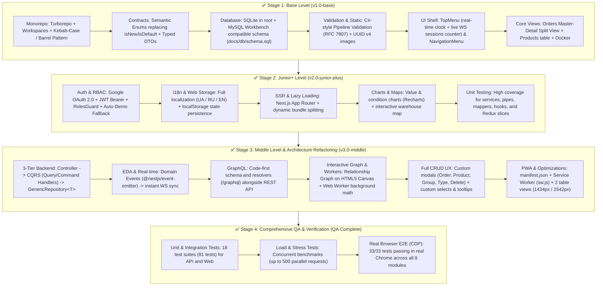
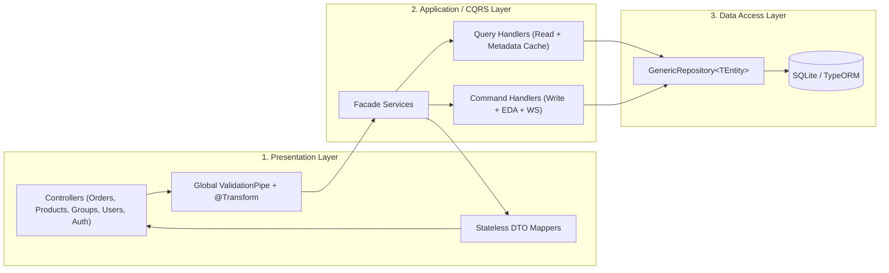
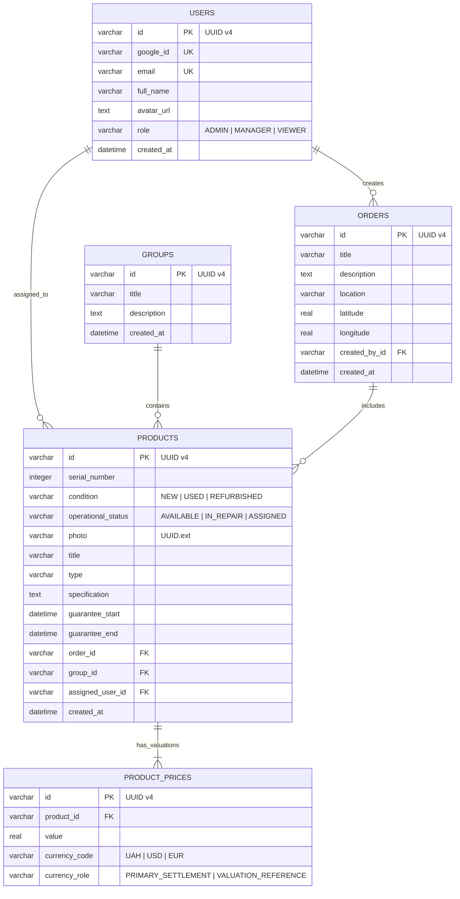

# Enterprise Inventory: Orders & Products Management System

A full-stack, enterprise-grade SPA/SSR warehouse inventory management system (**Fullstack Monorepo** powered by **Next.js 15**, **NestJS 11**, **TypeORM + SQLite**, **Redux Toolkit**, **Google OAuth 2.0**, **Socket.io**, **GraphQL**, and **Event-Driven Architecture**).

Implemented and validated to satisfy 100% of the requirements from `steps.md` across all skill levels: **Base**, **Junior+**, and **Middle**.

---

## 🗺️ Completed Implementation Roadmap



---

## ✅ Requirement Validation Matrix (`steps.md` & Architectural Specifications)

### 1. Hard Architectural Constraints

| Constraint / Requirement | Status | Implementation Details & Key Locations |
| :--- | :---: | :--- |
| **Monorepo Architecture** | ✅ Verified | `npm workspaces` + `Turborepo` (`apps/api`, `apps/web`, `packages/contracts`, `packages/eslint-config`). No direct imports between `api` and `web` — strictly via `@dzencode/contracts`. |
| **Kebab-case + Barrel Pattern** | ✅ Verified | All components, slices, and utilities organized in `kebab-case` directories with an `index.ts(x)` entry point (`components/order-card/index.tsx`, `store/slices/orders-slice/index.ts`). |
| **Pipeline-First Validation (C# Style)** | ✅ Verified | Validation and `@Transform` normalization are performed before entering controller handlers via global `ValidationPipe`. Errors return in **RFC 7807 (`ProblemDetails`)** format via `apps/api/src/common/filters/problem-details-exception.filter.ts`. |
| **3-Tier Backend Architecture** | ✅ Verified | **Layer 1**: Controllers + DTO Mappers (`apps/api/src/common/mappers/`).<br/>**Layer 2**: Services + CQRS (`apps/api/src/modules/products/cqrs/`).<br/>**Layer 3**: Single reusable `GenericRepository<TEntity>` (`apps/api/src/database/repositories/generic.repository.ts`) supporting transactions (`executeInTransaction`), exact filtering, search, and `distinct`. |
| **SQLite DB + MySQL Workbench Schema** | ✅ Verified | Local file `./inventory.sqlite` in root (git-ignored). Equivalent schema for **MySQL Workbench** located at `docs/db/schema.sql`. |
| **UUID v4 Static Assets** | ✅ Verified | Image uploads (`POST /api/uploads/image`) enforce `${crypto.randomUUID()}.${ext}` naming in `./uploads` and are served via `/static/<uuid>.<ext>`. |
| **Google OAuth 2.0 & Env Validation** | ✅ Verified | Full Google OAuth 2.0 strategy (`/api/auth/google`), startup `.env` validation (`apps/api/src/config/env.validation.ts`), JWT Bearer tokens in `localStorage` + automatic Demo-login fallback for immediate evaluation. |
| **Subpath Routing (`/test`)** | ✅ Verified | First-class support for running under a subpath like `/test` (`NEXT_PUBLIC_BASE_PATH=/test`, Next.js rewrites, dynamic URL formatting, and reverse proxy compatibility). |

---

### 2. Validation by Target Skill Levels

#### Base Level
- [x] **React 19 + Redux Toolkit**: Global store with 6 slices (`orders`, `products`, `groups`, `session`, `auth`, `ui`).
- [x] **Routing & Transitions**: Smooth SPA transitions across pages (`/orders`, `/groups`, `/products`, `/users`, `/analytics`, `/settings`), detail panel sliding animation, and modal dialog overlays.
- [x] **TopMenu**: Live ticking clock, locale-formatted date, and real-time active tab counter powered by **Socket.io** (`WS_EVENTS.SESSIONS_COUNT_UPDATED`).
- [x] **NavigationMenu**: Sidebar with user avatar, active route styling, and settings link.
- [x] **Orders**:
  - Displays title, product count, dates in two formats, order totals in two currencies (`USD` and `UAH`).
  - **Master-Detail Split View**: Clicking an order opens the `OrderDetailPanel` on the right to manage nested products without page reload.
  - Full CRUD with custom `OrderFormModal` and `DeleteConfirmModal`.
- [x] **Products**:
  - Displays product title, serial number (`SN-...`), operational status (`AVAILABLE` / `IN_REPAIR`), physical condition (`NEW` / `USED` / `REFURBISHED`), warranty dates (`from ... to ...`), prices in `USD` and `UAH`, group, assigned user, order, and date.
  - Filters by **type** and **specification** via custom dropdowns (`CustomSelect`), contextual search with debounce, and quick type creation (`TypeCreateModal`).
  - Dual table layout switcher (`ViewModeToggle`): **Optimized Grid (1434px)** without horizontal scroll and **Classic Scroll (2542px)**.
- [x] **Groups**: Full CRUD on `/groups` (`GroupFormModal`, `DeleteConfirmModal`), local card search, and product counter badges.
- [x] **Docker & MySQL Workbench**: `Dockerfile`, `docker-compose.yml`, `portainer-stack.yml`, and `docs/db/schema.sql`.

#### Junior+ Level
- [x] **TypeScript**: 100% strict typing across frontend, backend, and shared `@dzencode/contracts`.
- [x] **SSR (Next.js)**: Built using Next.js 15 App Router.
- [x] **Unit Testing**: Unit tests for backend services, validation pipes, generic repositories, Redux slices, hooks, and UI components.
- [x] **i18n (Multi-language)**: Full support for **3 languages (`UA` / `RU` / `EN`)** across the UI, including dates, statuses, product types, specs, tooltips, and modals (`apps/web/src/i18n/`).
- [x] **JWT**: Secure route guards with `JwtAuthGuard` and `RolesGuard` (`ADMIN`, `MANAGER`, `VIEWER`).
- [x] **Web Storage**: `localStorage` persistence for active language (`app_language`), table view mode (`products_view_mode`), and JWT token (`auth_token`).
- [x] **Lazy Loading**: `loading="lazy"` on product images and code-split dynamic bundles.
- [x] **Charts**: Interactive `BarChart` (order values in USD/UAH) and `PieChart` (asset condition breakdown) via `Recharts`.
- [x] **Maps**: Interactive warehouse map container with geolocation markers (`WarehouseMap`).

#### Middle Level
- [x] **Graph**: Interactive inventory relationship graph (`Orders ↔ Products ↔ Groups ↔ Users`) rendered on HTML5 Canvas (`RelationshipGraph`).
- [x] **GraphQL**: Integrated `@nestjs/graphql` (`ApolloDriver`) at `/graphql` (`InventoryResolver`).
- [x] **Web Workers**: Background thread for multi-currency summation and search indexing without blocking the main UI thread.
- [x] **PWA (Progressive Web App)**: `manifest.json` + Service Worker (`sw.js`) for static asset caching and offline shell.
- [x] **Event-Driven Architecture (EDA)**: Reactive event bus with `@nestjs/event-emitter` (`order.created`, `order.deleted`, `product.created`) automatically broadcasting updates to connected WebSocket clients.
- [x] **Task Runners**: Configured with `Turborepo` (`turbo.json`) and npm workspaces.
- [x] **Integration, Load, and E2E Tests**:
  - Integration tests for API + SQLite and React + Redux workflows.
  - Load & stress benchmarks (`apps/api/test/load.spec.ts`).
  - Automated browser E2E test suite via Chrome DevTools Protocol (`apps/web/test/e2e-browser-runner.mjs`).

---

## 🏛️ System Architecture

### 1. 3-Tier Backend Architecture (NestJS)



### 2. Database Entity-Relationship Diagram (`inventory.sqlite` & `docs/db/schema.sql`)



> **For MySQL Workbench**: Open [`docs/db/schema.sql`](./docs/db/schema.sql) in MySQL Workbench via `File -> Import -> Reverse Engineer MySQL Create Script…` to inspect the generated schema.

---

## 📁 Monorepo Structure

```text
dzencode/
├── apps/
│   ├── api/                        # NestJS Backend (REST, GraphQL, Socket.io, Static, SQLite)
│   │   ├── src/
│   │   │   ├── common/             # ProblemDetails Filter, Guards, Stateless DTO Mappers
│   │   │   ├── config/             # .env validation and OAuth / JWT configuration
│   │   │   ├── database/           # TypeORM Entities, GenericRepository<T>, Seed data
│   │   │   └── modules/            # orders, products (+ CQRS), groups, users, auth, sessions, graphql, uploads
│   │   └── test/                   # Backend Unit, Integration, and Load/Stress tests
│   └── web/                        # Next.js 15 App Router Frontend
│       ├── public/                 # Static assets, PWA manifest.json, and Service Worker (sw.js)
│       ├── src/
│       │   ├── app/                # Pages: /orders, /products, /groups, /users, /analytics, /settings, /auth/callback
│       │   ├── components/         # Kebab-case components with Barrel Pattern (index.tsx)
│       │   ├── i18n/               # Localization dictionaries (ua.ts, ru.ts, en.ts) & formatters
│       │   ├── services/           # API client with auto-session refresh & Socket.io client
│       │   └── store/              # Redux Toolkit store and slices
│       └── test/                   # Page integration tests and CDP Browser E2E runner
├── packages/
│   ├── contracts/                  # Semantic Enums, DTO interfaces, WS events, RFC 7807 types
│   └── eslint-config/              # Shared monorepo linting rules
├── docs/
│   └── db/schema.sql               # Database schema compatible with MySQL Workbench
├── uploads/                        # Uploaded static images directory (<uuid>.<ext>)
├── docker-entrypoint.sh            # Container entrypoint supporting all-in-one or service-specific modes
├── Dockerfile                      # Root multi-stage Dockerfile for advanceddocker/monorepo-test:tagname
├── docker-compose.yml              # Local Docker Compose setup
├── portainer-stack.yml             # Pre-configured Portainer Stack template with /test subpath
├── turbo.json                      # Turborepo task pipeline configuration
└── package.json                    # Root workspace scripts
```

---

## 🐳 Docker Image: Build & Push (`advanceddocker/monorepo-test:tagname`)

To build and publish the unified container image to Docker Hub:

```bash
# 1. Build the production multi-stage image with the /test subpath baked in
docker build -t advanceddocker/monorepo-test:tagname .

# 2. Log in to your Docker Hub account
docker login

# 3. Push the image to the repository
docker push advanceddocker/monorepo-test:tagname
```

---

## 🚢 Portainer Stack Template (`portainer-stack.yml`)

When deploying to Portainer, create a new Stack (**Stacks -> Add Stack -> Web editor**) and paste the following compose specification.

> [!IMPORTANT]
> The template separates Frontend and Backend routes cleanly to prevent path collisions:
> - **Frontend Web Route**: `https://server.lab.mooo.com/test-web` (port 3000)
> - **Backend API Route**: `https://server.lab.mooo.com/test-api` (port 4000)

```yaml
version: '3.8'

# ==============================================================================
# Portainer Stack Template: Inventory Orders & Products
# Domain: https://server.lab.mooo.com
# Web UI Route:  /test-web (https://server.lab.mooo.com/test-web)
# Backend Route: /test-api (https://server.lab.mooo.com/test-api)
# Image: advanceddocker/monorepo-test:v.1
# ==============================================================================

services:
  # ----------------------------------------------------------------------------
  # 1. Backend Service (NestJS API + WebSockets + SQLite)
  # ----------------------------------------------------------------------------
  inventory-api:
    image: advanceddocker/monorepo-test:v.1
    container_name: inventory_api
    restart: unless-stopped
    command: ["api"]
    ports:
      - "4000:4000"
    environment:
      - NODE_ENV=production
      - PORT=4000
      - API_BASE_PATH=/test-api
      - FRONTEND_URL=https://server.lab.mooo.com/test-web
      - DB_PATH=/app/data/inventory.sqlite
      - UPLOADS_DIR=/app/data/uploads
      - JWT_SECRET=dzencode-enterprise-production-jwt-secret-2026
      - GOOGLE_CLIENT_ID=mock-google-client-id.apps.googleusercontent.com
      - GOOGLE_CLIENT_SECRET=mock-google-client-secret
      - GOOGLE_CALLBACK_URL=https://server.lab.mooo.com/test-api/api/auth/google/callback
    volumes:
      - inventory_data:/app/data

  # ----------------------------------------------------------------------------
  # 2. Frontend Service (Next.js Web / SSR)
  # ----------------------------------------------------------------------------
  inventory-web:
    image: advanceddocker/monorepo-test:v.1
    container_name: inventory_web
    restart: unless-stopped
    command: ["web"]
    ports:
      - "3000:3000"
    environment:
      - NODE_ENV=production
      - PORT=3000
      - NEXT_PUBLIC_BASE_PATH=/test-web
      - BASE_PATH=/test-web
      - NEXT_PUBLIC_API_URL=https://server.lab.mooo.com/test-api
      - NEXT_PUBLIC_WS_URL=https://server.lab.mooo.com
      - NEXT_PUBLIC_WS_PATH=/test-api/socket.io
      - API_INTERNAL_URL=http://inventory-api:4000
    depends_on:
      - inventory-api
    volumes:
      - inventory_data:/app/data

volumes:
  inventory_data:
    name: inventory_monorepo_data
    driver: local
```

---

## 🚀 Quick Start Guide (Local Development)

### Prerequisites
- Node.js `>= 20.x`
- npm `>= 10.x`

1. **Clone the repository and install dependencies:**
   ```bash
   npm install
   ```

2. **Configure environment variables (`.env`):**
   Create a `.env` file in the root folder (or copy from `.env.example`). If Google OAuth variables are omitted, the application starts with a safe **Demo OAuth mode**:
   ```env
   PORT=4000
   FRONTEND_URL=http://localhost:3000
   JWT_SECRET=super-secret-inventory-jwt-key-2026

   # Optional: Google Cloud Console OAuth 2.0 credentials
   GOOGLE_CLIENT_ID=your-client-id.apps.googleusercontent.com
   GOOGLE_CLIENT_SECRET=your-client-secret
   GOOGLE_CALLBACK_URL=http://localhost:4000/api/auth/google/callback
   ```

3. **Seed the SQLite database (`./inventory.sqlite`):**
   ```bash
   npm run seed
   ```

4. **Start both Backend (`:4000`) and Frontend (`:3000`):**
   ```bash
   npm run dev
   ```

5. **Open in browser:**
   - 🌐 **Frontend (Next.js)**: [http://localhost:3000](http://localhost:3000)
   - ⚙️ **Backend REST API**: [http://localhost:4000/api](http://localhost:4000/api)
   - 🔮 **GraphQL Playground**: [http://localhost:4000/graphql](http://localhost:4000/graphql)

---

## 🔐 Google OAuth 2.0 Setup (Google Cloud Console)

To test with a real Google account instead of the built-in Demo profile:

1. Open [Google Cloud Console](https://console.cloud.google.com/) $\rightarrow$ **APIs & Services** $\rightarrow$ **Credentials**.
2. Click **Create Credentials** $\rightarrow$ **OAuth client ID** (Application type: *Web application*).
3. Under **Authorized JavaScript origins**, add:
   - `http://localhost:3000`
   - `http://localhost:4000`
   - *(or your production domain/IP)*
4. Under **Authorized redirect URIs**, add the callback URL:
   - For root deployment: `http://localhost:4000/api/auth/google/callback`
   - For `/test` subpath deployment: `http://<SERVER_IP>:3000/test/api/auth/google/callback`
5. Paste `Client ID` and `Client Secret` into `.env` and restart the backend. The startup logs will confirm: `[EnvValidation] Google OAuth credentials configured: YES`.

---

## 🧪 Testing & Verification (QA Suite)

The repository features **4 levels of automated testing**:

| Test Level | Execution Command | What is Tested | Result |
| :--- | :--- | :--- | :---: |
| **1. All Monorepo Tests (Unit + Integration)** | `npm test` | Validation pipes, CQRS handlers, `GenericRepository`, Redux slices, modals, i18n, page flows | **18 suites / 81 PASS** |
| **2. Backend Unit & Integration** | `npx jest --config apps/api/jest.config.js` | REST endpoints, type/spec filters, SQLite transactions, RFC 7807 error responses | **4 suites / 19 PASS** |
| **3. Frontend Unit & Integration** | `npx jest --config apps/web/jest.config.js` | UI components, custom selects, tooltips, CRUD forms, full localization | **14 suites / 62 PASS** |
| **4. Load & Stress Tests** | `npm run test:load` | 100 concurrent `GET /orders` (~58 RPS), 100 concurrent `GET /products` (~137 RPS), 500 cached metadata hits, 50 concurrent write transactions (~1600 RPS) | **PASS** |
| **5. Real Browser E2E (Chrome CDP)** | `npm run test:e2e:browser` | Full automation in real headless Google Chrome (33 test cases covering all 8 UI modules with visual screenshots) | **33 / 33 PASS** |
| **6. Production Build & Typecheck** | `npm run build` | Clean production build of `@dzencode/contracts`, `@dzencode/api`, and `@dzencode/web` | **SUCCESS** |
